#  Magpie

[](https://github.com/misterpowerful/magpie/actions/workflows/ci.yml)

Magpie is a self-hosted job-search pipeline. Three times a week it collects
new listings from job boards, company career pages and job-alert emails. It
throws out the ones that clearly don't fit using plain rules. Then it asks
Claude to judge each remaining listing against your resume and criteria, and
sends a push notification when something is a strong match. It also notices
"thank you for applying" emails and marks those listings applied.


<sub>Screenshots use demo data.</sub>

## How it works

Each run takes listings through a series of stages. A listing's `state`
records how far it got, so a run that stops partway (time cap, rate limit)
picks up where it left off next time. Nothing has to be redone.

```mermaid
flowchart LR
    A["<b>1. Intake</b><br/>RSS / APIs, career pages,<br/>job-alert emails (IMAP)<br/><i>duplicates merged</i>"]
    B["<b>2. Stub filters</b><br/>title and location rules"]
    C["<b>3. Enrichment</b><br/>fetch full posting;<br/>flag login walls and<br/>bot checks as needs-browser"]
    D["<b>4. Hard filters</b><br/>salary, tech stack,<br/>location eligibility"]
    E["<b>5. Scoring</b> 🤖<br/>Claude rates Strong / Medium / Weak<br/>vs. your resume and criteria"]
    F["<b>6. Notify</b><br/>push notification<br/>for Strong matches"]

    A --> B --> C --> D --> E --> F

    classDef intake fill:#3B82F6,stroke:#1E40AF,color:#fff
    classDef stub fill:#14B8A6,stroke:#0F766E,color:#fff
    classDef enrich fill:#22C55E,stroke:#15803D,color:#fff
    classDef hard fill:#F59E0B,stroke:#B45309,color:#fff
    classDef score fill:#8B5CF6,stroke:#5B21B6,color:#fff
    classDef notify fill:#EF4444,stroke:#B91C1C,color:#fff

    class A intake
    class B stub
    class C enrich
    class D hard
    class E score
    class F notify
```



1. **Intake.** Built-in adapters read job boards (We Work Remotely, LaraJobs,
   Remotive, Remote OK), using RSS feeds or public APIs. Any other career page
   is read with XPath selectors you set per site. Job-alert emails are read
   over IMAP. Duplicates are merged by canonical URL and by company + title.
2. **Stub filters.** Title and location rules drop obvious mismatches before
   any further work is spent on them.
3. **Enrichment.** Magpie fetches each surviving posting. Pages behind a login
   wall, a bot check (Cloudflare and similar), or that are empty until
   JavaScript runs are recognised and set aside as needing a browser, so they
   aren't mistaken for empty postings.
4. **Hard filters.** Rules handle tiered pay ranges, "up to" ceilings, OTE and
   hourly rates; check the tech stack, softening "or similar" requirements; and
   check location eligibility.
5. **Scoring.** Only listings that pass every filter reach the LLM. Claude
   rates each one Strong, Medium or Weak against your resume and your own
   written criteria, and gives reasons. A listing is scored again only if your
   resume or criteria have changed since.
6. **Notify.** Strong matches trigger a Pushover notification.

Runs happen Monday, Wednesday and Friday at 2am Central time. There's a daily
catch-up run if a backlog is waiting, and a scan for application
confirmations every four hours.

### Where AI is used, and where it isn't

Everything up to scoring is ordinary code: fast, free, and predictable. Claude
is used in only two places:

| Task | Model | Why |
|---|---|---|
| Scoring a listing against your resume | Claude Sonnet 5.5 | Needs judgment |
| Reading a job-alert email no parser recognises | Claude Haiku 5.5 | Cheap extraction, used only as a fallback |

Claude runs through the Claude Code CLI on a Claude Pro plan. Every call is
recorded with its token usage and an "API-equivalent" cost, and tagged with
the run it belongs to. That's what powers the cost breakdowns below. The
prompt is built in a fixed order, with the parts that never change (scoring
instructions, resume, criteria) first and the posting last, so that within a
run everything but the posting can be served from Claude's prompt cache.

## Features

**Insights.** Cost per run, broken down by task and by model; which sources
produce Strong matches; and how each run's rating mix changes over time. Each
dashboard tile links to the matching Insights tab.


**Your criteria, your resume.** You write what the scorer should judge on in
your own words, and upload your resume (PDF, Word or text). You can see, and
correct, the exact text Claude reads. If you change either one, a single
button queues pending listings to be scored again. That never happens
automatically, because every re-score costs usage.


**Adding a site checks how it can be read.** Before you save a site, Magpie
fetches the URL from the server and tells you which way it can read it:
- it's a feed or API, with a built-in adapter if there is one;
- the server can read the page directly, plus any feed the page advertises;
- the page needs a real browser (a login wall, bot protection, or content that
  appears only after JavaScript runs).

The same checks run on every scheduled fetch, so if a site later puts up a
wall, it's flagged instead of quietly returning nothing.


Also included:
- Live progress updates during a run, over WebSockets (Laravel Reverb).
- Every API error carries a reference ID that the UI shows, so a failure on
  screen can be matched to its server log line.
- A layout that works on phones.

## Stack

- **Backend:** Laravel 13 on PHP 8.3, with SQLite in WAL mode. The scheduler
  runs the pipeline, and Reverb pushes live updates.
- **Frontend:** Vue 3 with TypeScript, Quasar and Tailwind CSS 4, built with
  Vite. Pages load on demand.
- **AI:** Claude Sonnet 5.5 and Haiku 5.5 through the Claude Code CLI.
- **Quality:**
  - 313 Pest tests.
  - PHPStan (level 6, with Larastan) and Laravel Pint.
  - The frontend type-checks with `vue-tsc`.
  - CI runs all of the above, plus a production build, on every push and pull
    request.

### Design notes

- **External services sit behind interfaces.** The LLM (`LlmDriver`), the
  mailbox (`MailSource`) and notifications (`Notifier`) are each behind an
  interface, so tests swap in fakes, and HTTP and the CLI are faked in tests
  too.
- **One definition per rule.** Shared logic lives in one place:
  - `PageAccess` decides whether a page needs a browser, for enrichment, the
    URL check and site runs alike.
  - `SourceBuckets` groups sources for both the dashboard and Insights.
  - `shared/lib/ratings.ts` defines each rating's label and colour once.
- **Accessible charts.** Ratings use a single teal ramp checked for contrast
  and colour-blindness. Chart values show on hover and on keyboard focus, and
  every value is also printed next to its bar or listed in a table, so no
  value is only readable on hover.

## Running it

**Requirements:**
- PHP 8.3 and Composer
- Node 22
- The `claude` CLI, installed and logged in for the user that runs the
  scheduler

**Setup:**

```bash
composer setup          # install deps, create .env, generate a key, migrate, build the frontend
php artisan db:seed --class=AdminUserSeeder
```

**Configuration.** Set these in `.env`:

| Setting | Purpose |
|---|---|
| `ADMIN_EMAIL`, `ADMIN_PASSWORD` | The owner's login; runs act on this account |
| `MAGPIE_MAIL_*` | IMAP mailbox and the labels used for job-alert emails |
| `MAGPIE_LLM_SCORING_MODEL`, `MAGPIE_LLM_TRIAGE_MODEL` | Default to `claude-sonnet-5-5` / `claude-haiku-5-5` |
| `PUSHOVER_TOKEN`, `PUSHOVER_USER_KEY` | Phone notifications (optional) |
| `REVERB_*`, `VITE_REVERB_*` | Live run updates (optional) |

**Scheduling.** Add Laravel's scheduler to cron:

```cron
* * * * * cd /path/to/magpie && php artisan schedule:run >> /dev/null 2>&1
```

**Useful commands:**

```bash
php artisan magpie:run --trigger=schedule   # run the full pipeline now
php artisan magpie:process-emails           # email intake only
php artisan magpie:check-confirmations      # scan for application confirmations
php artisan test                            # the test suite
```

## License

MIT, see [LICENSE](LICENSE).
